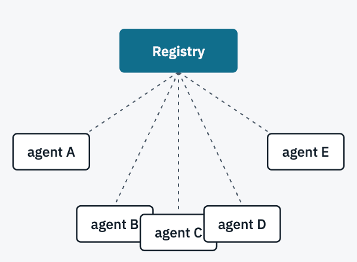
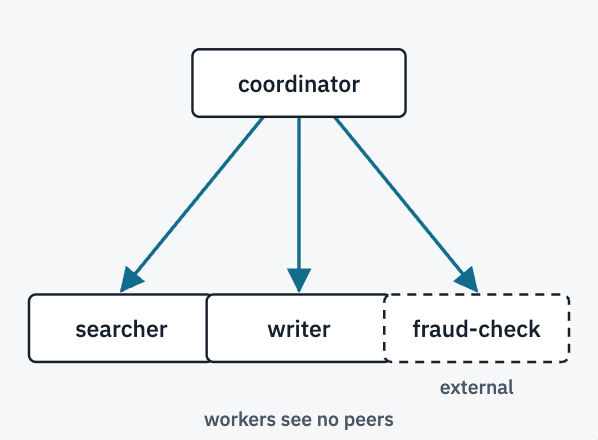
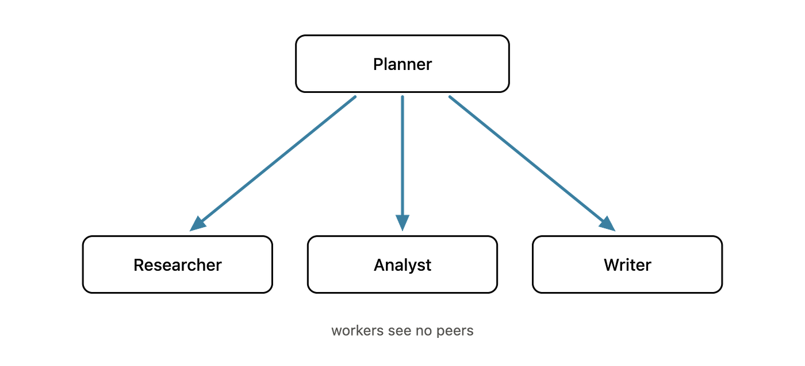

As AI agents evolve from isolated AI agents into distributed, collaborative systems, the industry is trying to solve the problem of making AI agents discoverable, reusable, trustworthy, and manageable.

> How does one agent find another? How does it discover another agent's capabilities? And how do we manage these relationships as agents are deployed, updated, and scaled?

To address these challenges, the industry is investing heavily in dedicated agent registries and discovery infrastructure. The [A2A protocol](https://a2a-protocol.org/) describes [Curated Registries (Catalog-Based Discovery)](https://github.com/a2aproject/A2A/blob/main/docs/topics/agent-discovery.md#2-curated-registries-catalog-based-discovery) as one possible approach. More recent community initiatives, including [AI Catalog](https://ai-catalog.io/) and [Agentic Resource Discovery (ARD)](https://agenticresourcediscovery.org/), are exploring standardized resource descriptions and federated discovery across agent ecosystems. Major cloud providers are also introducing their own registries for agent inventory, search, reuse, and governance.



<p class="caption"><strong>Registry</strong> - Everything registered is findable by every client that queries it. Visibility is then narrowed with filters and entitlements.</p>

These efforts address real problems. But they also invite a more fundamental architectural question:

**_What if the agentic platform already knows which agents exist, what roles they play, and which agents need to communicate? Why should those agents need another system to discover one another?_**

With [_Kynomesh_](https://github.com/kynoproj/kynomesh), a Kubernetes-native declarative platform for distributed multi-agent systems, we can approach agent discovery differently. Instead of maintaining an independent registry and asking agents to search it for collaborators, _Kynomesh_ derives peer discovery directly from the declared agentic topology. Each agent receives the peer information relevant to its role and communication pattern. The platform already knows the relationships. There is no need to rediscover them.

> The central idea is simple: Agent discovery should be an intrinsic capability of the agentic system, not necessarily another infrastructure service.



<p class="caption"><strong>Declared topology</strong> - Under the Supervisor pattern the entry agent is given its workers. Nobody else is given anyone.</p>

## The Problem with Dedicated Agent Registries

Consider a simple research workflow involving four agents:

- _A Planner that coordinates the workflow._
- _A Researcher that gathers information._
- _An Analyst that interprets findings._
- _A Writer that produces the final report._

The Planner communicates with the three workers, but the workers do not necessarily communicate with one another.



The communication relationships are already defined by the application's architecture. Why should the Planner query an external registry to rediscover its workers? A dedicated registry can introduce additional complexity:

- **Another infrastructure component:** A registry must be operated, secured, monitored, and maintained.
- **Duplicated information:** Registry metadata must remain synchronized with actual agent deployments.
- **More client logic:** Agents or their SDKs need registry queries, endpoint resolution, caching, and error handling.
- **Additional discovery policies:** Registry visibility may require separate filters and entitlements, duplicating relationships already expressed in the agentic topology.
- **Unnecessary exposure:** Broad discovery can reveal agents that a particular workload does not need to know about.

Well-designed registries can address many of these concerns through automation and access controls. But the more fundamental issue remains:

> **Why introduce another discovery layer when the agentic platform already has the information needed for discovery?**

## Kynomesh: Declare the System, Derive Discovery

Kynomesh approaches multi-agent orchestration declaratively. Its central abstraction is the [**_AgentSet_**](https://kyno.sh/stable/core-concepts/agentset/), a Kubernetes custom resource that describes cooperating agents and their communication pattern. For example:

```yaml
apiVersion: kynomesh.kyno.sh/v1alpha1
kind: AgentSet
metadata:
  name: research-team
spec:
  pattern: Supervisor
  entry: coordinator
  agents:
    - name: coordinator
      container:
        image: example/coordinator:latest
    - name: researcher
      container:
        image: example/researcher:latest
    - name: analyst
      container:
        image: example/analyst:latest
```

This declaration already defines which agents exist, their roles in the system, and their communication relationships. Kynomesh's controller creates the corresponding `AgentDeploy` resources and derives peer relationships from the declared topology. Each agent receives its relevant peer information through a generated `topology.json`. An agent doesn't need access to the Kubernetes API or a separate registry to discover its peers. Using the _Kynomesh_ SDK, an agent can simply write:

```python
from kynomesh import client

async def discover_peers():
    discovered = []

    for name in client.peers():
        card = await client.resolve_agent_card(name)
        discovered.append({
            "name": name,
            "description": card.description,
            "skills": [skill.name for skill in card.skills],
        })

    return discovered
```

The SDK resolves the declared peer, retrieves its Agent Card, and establishes an A2A client ([_Code examples_](https://github.com/kynoproj/kynomesh-examples)).

**The `AgentSet` acts as the natural registry.** The platform provides discovery without introducing an additional lookup service.

## Discovery Should Be Distributed and Need-to-Know

_Traditional_ registries organize discovery around the agents available in a catalog. Visibility can be restricted through filters and access policies. _Kynomesh_ takes a different approach: **discovery scope follows the declared communication topology.** Different communication pattern has different discovery behavior. For example:

- **Supervisor:** The entry agent discovers its workers; workers do not automatically discover one another.
- **Sequential:** Each agent discovers only its next peer.
- **Handoff:** Participating agents can discover one another for flexible collaboration.

The AgentSet declaration provides a common source of truth, while _Kynomesh_ projects a different peer view to each agent. This creates a logically distributed discovery model. Agents do not need to enumerate an enterprise-wide catalog. They receive the information relevant to their roles. Changing the declared communication pattern changes discovery relationships without requiring developers to implement new registry-querying logic. This follows a simple principle:

> **An agent should only discover the peers it needs.**

Discovery scoping is not a replacement for authentication or authorization, but it reduces unnecessary exposure of agent information.

## Discovery and Lifecycle Belong Together

Agent discovery is not just about finding an endpoint. Agents are updated, scaled, and redeployed. Their Agent Cards and capabilities can change. With the approach of a separate registry, it is challenging to remain synchronized with these changes.

_Kynomesh_ integrates peer discovery with the agent lifecycle. For managed agents, Kubernetes Services provide stable endpoints and route traffic to ready replicas. _Kynomesh_ also provides an opt-in `driftReload` mechanism that detects relevant Agent Card changes and restarts affected agent pods to refresh cached peer information. The platform therefore manages deployment, topology, and discovery together.

Kynomesh also supports `externalAgents`, allowing known external A2A endpoints to participate in the declared topology. Even when an agent is outside the cluster, a dedicated registry is not required if its endpoint is already known. The endpoint can simply be declared as part of the application:

```yaml
externalAgents:
  - name: fraud-check
    url: https://fraud-check.example.com
```

## When Does a Dedicated Registry Add Value?

Registries remain useful for open-ended capability search, agent marketplaces, enterprise-wide inventory, and cross-organization discovery. For example, searching for capabilities across organizations, browsing enterprise-wide agent inventories, or dynamically selecting agents from independently managed providers.

But these are fundamentally different from discovering agents whose relationships are already declared as part of an application.

## Conclusion

**_Agent discovery is essential, a dedicated agent registry is not._** Before building an agent registry, ask whether you actually have a discovery problem - or whether your platform has already solved it.

_Kynomesh_ does not claim to replace every enterprise registry function. It turns the system's topology directly into discovery capabilities - without a separate registry, duplicated configuration, or additional registry-client logic.

## References

- [A2A Protocol - Agent Discovery](https://github.com/a2aproject/A2A/blob/main/docs/topics/agent-discovery.md)
- [A2A Agent Registry Community Discussion](https://github.com/a2aproject/A2A/discussions/741)
- [AI Catalog](https://ai-catalog.io/)
- [Agentic Resource Discovery (ARD) Specification](https://github.com/ards-project/ard-spec)
- [Kynomesh - GitHub Repository](https://github.com/kynoproj/kynomesh)
- [Kynomesh - Documentation](https://kyno.sh)
- [Kynomesh - Examples](https://github.com/kynoproj/kynomesh-examples)
